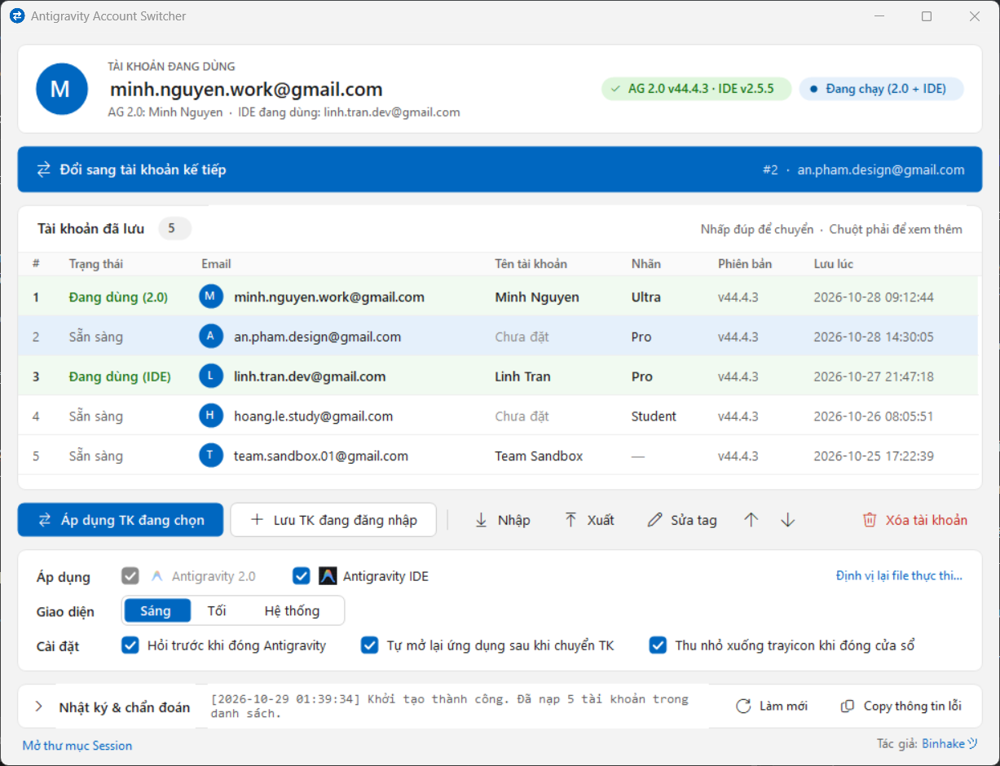

# Antigravity Account Switcher

[Tiếng Việt](README.md) · **English**

[](../../releases/latest)
[](../../releases)

[](LICENSE)

A small Windows tool to **save and quickly switch between multiple Google accounts** in **Antigravity 2.0** and **Antigravity IDE**, without signing out and back in by hand.

<picture>
  <source media="(prefers-color-scheme: dark)" srcset="docs/screenshot-dark.png">
  
</picture>

<sub>The screenshot follows your GitHub light / dark theme. All accounts shown are fake.</sub>

> ⚠️ This is an **unofficial** tool, not affiliated with or endorsed by Google. Use it with your own accounts, at your own risk.

> ℹ️ The app's interface is in **Vietnamese**. Button names are quoted below with their meaning in parentheses.

## Features

- Save unlimited accounts; switch with a **double-click** or the **Đổi sang tài khoản kế tiếp** (switch to next account) button, which cycles through the list.
- Applies to **Antigravity 2.0**, optionally to **Antigravity IDE** at the same time.
- Closes the apps before switching and relaunches them afterwards (can be turned off).
- Backs up the current account before every switch, so a failed switch can be rolled back.
- Tag accounts, reorder them, and see their Google profile pictures.
- Export / import sessions as `.json` to move them to another PC.
- Windows 11 style UI with Light / Dark / System themes and high-DPI support.
- Minimizes to the system tray; switch accounts straight from the tray menu.
- Every error is written to its own file in `logs\` for easy bug reports.

## Requirements

- Windows 10 or Windows 11 (64-bit).
- .NET Framework 4.x (already included in Windows 10/11).
- Antigravity 2.0 installed (and Antigravity IDE if you use the IDE feature).

## Installation

1. Download `AntigravitySwitcher.exe` from [Releases](../../releases).
2. Put it in its own folder (e.g. `D:\Tools\AntigravitySwitcher\`). The app stores its data in a `profiles\` folder next to the `.exe`, so the folder must be writable (avoid `C:\Program Files`).
3. Run `AntigravitySwitcher.exe`. For a desktop shortcut: right-click the file → **Show more options** → **Send to** → **Desktop (create shortcut)**.

### My antivirus flags it?

**Seeing the blue "Windows protected your PC" screen?** Click **More info** → **Run anyway**. You only need to do this once.

That screen is **SmartScreen**, not an antivirus. SmartScreen does not scan the file for malware. It warns because the file is **new and unsigned** and hasn't been downloaded enough times to build a reputation. The warning fades as more people download it.

**VirusTotal results for v1.0.1: 5/70** ([full report](https://www.virustotal.com/gui/file/633bea66e5af685919e7580ca4bcc6df9a39bbfacd22903e87fdab0ed9e4e862)):
- **Microsoft Defender, Kaspersky, ESET, Bitdefender** and 61 other engines: **nothing detected**.
- The 5 engines that flag it all use **machine-learning or heuristic predictions**, not a match for any known malware:
  - CrowdStrike (`malicious_confidence_60%`)
  - Malwarebytes (`MachineLearning/Anomalous`)
  - Trapmine (`moderate.ml.score`)
  - SecureAge
  - VirIT (`MSIL_Heur`)

  A false-positive report has been sent to Malwarebytes.

Machine-learning engines tend to misfire here because:
- the `.exe` is unsigned and has few users, and
- the app does things malware also does: it reads Windows Credential Manager, reads/writes Antigravity's login tokens and closes Antigravity's processes.

ESET may hold the file for a few minutes of analysis on first run, then lets it run normally.

The whole source is a single file, `AntigravitySwitcher.cs`, so you can review it and [build it yourself](#building-from-source) instead of using the downloaded `.exe`. If you trust it, add the app's folder to your antivirus exclusions.

## Usage

1. Sign in to an account in Antigravity as usual.
2. Click **Lưu TK đang đăng nhập** (save signed-in account).
3. Repeat for your other accounts.
4. Select an account in the list and click **Áp dụng TK đang chọn** (apply selected account), or double-click its row.

Tick **Antigravity IDE** in the **Áp dụng** (apply to) row to save / switch the IDE account as well. If an app is installed in a non-default folder, click **Định vị lại file thực thi…** (locate executable).

Save the signed-in account from the command line (no window; exit code `0` = success, `1` = error):

```bat
AntigravitySwitcher.exe --save-current
```

## Where data is stored

| Path (next to the `.exe`) | Contents |
|---|---|
| `profiles\accounts.json` | Saved accounts and their sessions (**contains tokens**). |
| `profiles\switcher_settings.json` | App settings. |
| `profiles\avatars\` | Downloaded profile pictures. |
| `profiles\last_rollback_backup.json` | Automatic backup taken before each switch (**contains tokens**). |
| `logs\Error_<date>_<time>.txt` | One file per error. Open or clear them with the **Log lỗi** (error logs) button in the **Nhật ký & chẩn đoán** (logs & diagnostics) panel. |

To uninstall, delete the folder. Apart from Antigravity's own sign-in data (Windows Credential Manager, `app_storage.json`, the IDE's `state.vscdb`), the app writes nothing to the Registry or anywhere else.

## Something went wrong?

1. Expand the **Nhật ký & chẩn đoán** (logs & diagnostics) panel at the bottom of the window to see what happened.
2. Click **Copy thông tin lỗi** (copy error info), or take the newest file from `logs\`.
3. Open an [issue](../../issues) and paste it in. Log files contain e-mail addresses and the PC name but **no** tokens; still, review them before posting publicly.

If `accounts.json` gets corrupted, the app does not overwrite it: it keeps a copy named `accounts.unreadable-<time>.json` so you can recover it.

## Security — read before use

- The sessions (OAuth tokens) of all accounts are stored **in plain text** in `profiles\accounts.json`. Anyone with this file can sign in as you.
- Exported session files (`antigravity_sessions_*.json`) contain tokens too. Share them only over a safe channel and delete them after importing.
- **Never** commit or share the `profiles\` folder or session files.
- The app sends tokens nowhere except Google's own servers:
  - `oauth2.googleapis.com`: only when saving an Antigravity IDE account, to fetch the account details.
  - `lh3.googleusercontent.com`: downloads public profile pictures, without any token.
- Antigravity's OAuth client is **not** in the source code. The app reads it from the `language_server` binary of your local Antigravity installation and caches it locally in `profiles\switcher_settings.json`.

## Building from source

No Visual Studio needed, only the C# compiler that ships with .NET Framework. Run in PowerShell from the repository root:

```powershell
C:\Windows\Microsoft.NET\Framework64\v4.0.30319\csc.exe /nologo /target:winexe /win32icon:AntigravitySwitcher.ico /out:AntigravitySwitcher.exe /r:System.dll /r:System.Drawing.dll /r:System.Windows.Forms.dll /r:System.Web.Extensions.dll AntigravitySwitcher.cs
```

This compiler only supports **C# 5**: no `$"..."`, `?.`, `nameof`, `out var` or `=>` member bodies.

## Repository layout

| Path | Contents |
|---|---|
| `AntigravitySwitcher.cs` | The entire source code (single file). |
| `AntigravitySwitcher.ico` | Icon embedded into the `.exe`. |
| `docs/` | Screenshots used in the README. |
| `.github/ISSUE_TEMPLATE/` | Bug report / feature request templates. |
| `legacy/antigravity_switcher.py` | The first Python (Tkinter) version, no longer maintained. |

## Contributing

Report bugs or suggest features in [Issues](../../issues). Pull requests are welcome. Please read [Building from source](#building-from-source) and stick to C# 5 syntax.

If this tool helps you, please give the repo a ⭐ so others can find it too.

## License

[MIT](LICENSE) © Binhake
